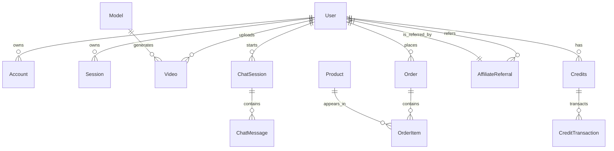

# DATABASE — hostamar.com

## Context

hostamar.com uses Prisma 5.22.0 over Turso/libsql (SQLite provider, `driverAdapters` preview feature). The schema is 1802 lines and lives at `prisma/schema.prisma`. Local dev uses WSL Podman Postgres; production uses Neon (AI video product DB) with `@neondatabase/serverless` over 443 (port 5432 blocked). Libsql (SQLite) is the Workers runtime DB.

**P4 Status: CLOSED** — `/models.json` 404 fixed (was @libsql/isomorphic-ws esbuild bug).
**P5 Status: IN PROGRESS** — f005 CDN Worker uses B2 for manifests, libSQL for live TV count.

## Task

Document Prisma tables, PK/FK relations, ER diagram, RLS strategy, and libsql vs Postgres trade-offs.

## Includes

### Core Tables (from schema.prisma)

| Table | PK | FK | Purpose |
|-------|-----|-----|---------|
| User | id | — | Auth identity (NextAuth) |
| Account | id | userId | NextAuth provider accounts |
| Session | id | userId | Session tokens |
| Video | id | uploaderId | Hostamar TV videos |
| Model | id | — | AI model catalog (models.json sync) |
| Order | id | userId | bKash/Nagad/Rocket/Stripe orders |
| OrderItem | id | orderId, productId | Line items |
| Product | id | creatorId | AI Store product |
| ChatSession | id | userId | Kai9000 AI chat |
| ChatMessage | id | sessionId | Chat history |
| Credits | id | userId | Credit balance (prepaid) |
| CreditTransaction | id | creditsId | Credit ledger |
| AffiliateReferral | id | referrerId, referredId | Affiliate tracking |
| WebhookEvent | id | — | bKash/Nagad webhooks (idempotency) |
| Deployment | id | userId | VPS deployment records |

### PK/FK Relations

- `User 1:N Account` (userId)
- `User 1:N Session` (userId)
- `User 1:N Video` (uploaderId)
- `Order 1:N OrderItem` (orderId)
- `Product 1:N OrderItem` (productId)
- `ChatSession 1:N ChatMessage` (sessionId)
- `Credits 1:N CreditTransaction` (creditsId)
- `User 1:N AffiliateReferral` (referrerId + referredId)

### ER Diagram (Mermaid)

### RLS (Row-Level Security)

- Auth layer enforces RLS via `session.userId` match on every query.
- No SQL-level RLS (SQLite doesn't support it). Application-level only.
- Prisma middleware rejects any query where `userId` doesn't match `session.userId`.
- Admin routes bypass RLS via `role: 'ADMIN'` check in session.

### libsql vs Postgres

| Aspect | libsql (Workers / local) | Postgres (Neon / Podman) |
|--------|--------------------------|--------------------------|
| Provider | `sqlite` + `@libsql/client/web` | `postgresql` + `@neondatabase/serverless` |
| Where | Cloudflare Workers, WSL dev | Production AI video DB, local Podman |
| Connection | HTTPS/fetch (libsql://) | TCP/SSL over 443 (port 5432 blocked) |
| Prisma adapter | `@prisma/adapter-libsql` | `@prisma/adapter-neon` |
| Migration | `prisma migrate dev` (local PG) | `prisma migrate deploy` (Neon) |
| Engine | WASM binary in `node_modules/.prisma` | Node.js native via serverless driver |

### P5 f005 Integration

- **Manifest sync**: `scripts/sync-manifest-to-b2.mjs` queries libSQL for live TV count
- **Query**: `SELECT COUNT(*) as count FROM Video WHERE status = 'published'`
- **Connection**: Uses `HOSTAMAR_DATABASE_URL` from Infisical (libsql:// with authToken)
- **AuthToken extraction**: Handles quoted URLs from Infisical export (`\"libsql://...?authToken=...\"`)
- **Fallback**: Returns 353 if DB unavailable (placeholder from B2 tv.json)

## Rules

- Never hardcode connection strings — read from Infisical/env (replaced with [REDACTED]).
- `prisma migrate dev` uses local Podman Postgres, never production Neon directly.
- Libsql schema changes applied via `prisma migrate dev` then synced to libsql endpoint.
- **B2 not R2**: All manifests and video assets on Backblaze B2 (f005/us-east-005), NOT Cloudflare R2
- **Infisical secrets**: ALL secrets in `/home/romel/automation/infisical.env` — NEVER commit
- **4x200 Probe**: `/tv`, `/api/tv`, `/api/tv/live`, `/models.json` must all return 200 with `cf-ray`, no `x-vercel`

## Output

This document. Read before touching `prisma/schema.prisma` or any DB query.